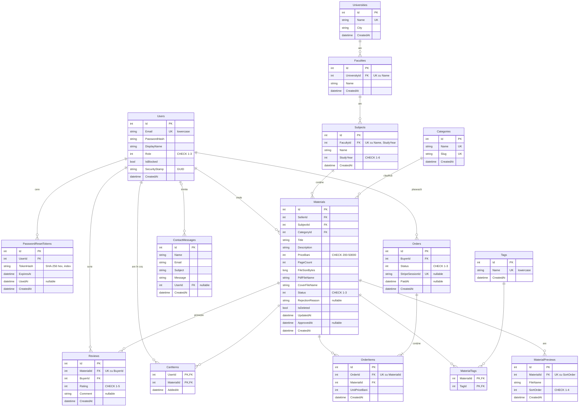

# Baza de date Notix

Baza de date este **SQLite**, administrată cu **Entity Framework Core** (code-first). Schema se creează din migrări (`backend/src/Notix.Api/Data/Migrations`), iar fiecare tabel are configurația lui în `Data/Configurations/*Configuration.cs`.

## Convenții

- Toate entitățile moștenesc `BaseEntity { Id, CreatedAt }`. Excepție fac tabelele de legătură `MaterialTags` și `CartItems`, care au cheie primară compusă.
- Enum-urile se stochează ca `int`, iar valorile permise sunt impuse cu `CHECK`:
  - `UserRole`: Buyer = 1, Seller = 2, Admin = 3;
  - `MaterialStatus`: Pending = 1, Approved = 2, Rejected = 3;
  - `OrderStatus`: Pending = 1, Paid = 2, Canceled = 3.
- Prețurile sunt întregi, în **bani** (1 leu = 100 bani), pentru că SQLite nu poate ordona după `decimal`.
- Datele calendaristice sunt `DateTime` în **UTC**. `NotixDbContext` le citește înapoi cu `Kind = Utc` și completează automat `CreatedAt`, `CartItems.AddedAt` și `Materials.UpdatedAt`.
- Toate cheile străine au `ON DELETE RESTRICT`: nu se poate șterge un rând folosit în altă parte (de exemplu o universitate care are facultăți).
- Materialele se șterg logic (`IsDeleted = 1`). **Nu** există un filtru global pentru `IsDeleted`: catalogul exclude explicit materialele șterse, iar biblioteca și descărcarea le văd în continuare, ca un cumpărător să nu-și piardă materialele plătite.

## Diagrama ER

## Constrângeri

| Tabel | Cheie primară | Unicitate | CHECK |
|---|---|---|---|
| Users | Id | Email | Role ∈ {1, 2, 3}; Email = lower(Email) |
| PasswordResetTokens | Id | — (index simplu pe TokenHash) | — |
| Universities | Id | Name | — |
| Faculties | Id | (UniversityId, Name) | — |
| Subjects | Id | (FacultyId, Name, StudyYear) | StudyYear între 1 și 6 |
| Categories | Id | Name; Slug | — |
| Materials | Id | — | PriceBani între 200 și 50000; Status ∈ {1, 2, 3} |
| MaterialPreviews | Id | (MaterialId, SortOrder) | SortOrder între 1 și 4 |
| Tags | Id | Name | Name = lower(Name) |
| MaterialTags | (MaterialId, TagId) | — | — |
| CartItems | (UserId, MaterialId) | — | — |
| Orders | Id | StripeSessionId (NULL permis de mai multe ori) | Status ∈ {1, 2, 3} |
| OrderItems | Id | (OrderId, MaterialId) | — |
| Reviews | Id | (MaterialId, BuyerId) | Rating între 1 și 5 |
| ContactMessages | Id | — | — |

## Justificarea formei normale 3 (3NF)

**1NF.** Fiecare coloană conține o singură valoare atomică și nu există grupuri repetitive. Etichetele unui material nu se țin ca listă într-o coloană (`"sql, baze de date"`), ci în tabelul de legătură `MaterialTags`. Imaginile de previzualizare sunt rânduri în `MaterialPreviews`, nu coloane `Preview1…Preview4`.

**2NF.** Toate tabelele cu cheie simplă (`Id`) sunt automat în 2NF. Tabelele cu cheie compusă respectă și ele regula:
- `MaterialTags (MaterialId, TagId)` nu are alte coloane;
- `CartItems (UserId, MaterialId)` are doar `AddedAt`, care depinde de **ambele** părți ale cheii (momentul în care *acest* utilizator a pus *acest* material în coș).

Atributele care depind doar de material (titlu, preț) sau doar de utilizator (nume) nu sunt copiate în aceste tabele.

**3NF.** Niciun atribut non-cheie nu depinde de alt atribut non-cheie:
- **`Materials` nu are `UniversityId` sau `FacultyId`.** Facultatea depinde de materie, iar universitatea depinde de facultate. Dacă le-am stoca pe material, am avea dependențele tranzitive `Id → SubjectId → FacultyId → UniversityId`. Ele se obțin prin join-ul `Materials → Subjects → Faculties → Universities`.
- **`StudyYear` stă pe `Subjects`**, pentru că anul de studiu ține de materie (Baze de date este în anul 3), nu de un material anume. Pe `Materials` ar fi depins de `SubjectId`, nu de cheie.
- **`City` stă pe `Universities`**, nu pe facultăți sau pe materiale.
- **Nu se stochează valori calculabile.** Acestea se calculează la interogare, deci nu pot ajunge să contrazică datele din care provin:
  - totalul unei comenzi = suma `OrderItems.UnitPriceBani`;
  - nota medie și numărul de recenzii = agregate din `Reviews`;
  - numărul de vânzări și încasările unui vânzător = agregate din `OrderItems` ale comenzilor cu `Status = Paid`.
- **`OrderItems.UnitPriceBani` nu este redundant** față de `Materials.PriceBani`. El reține prețul **din momentul cumpărării**, care rămâne valabil chiar dacă vânzătorul schimbă ulterior prețul. Este un fapt istoric, care depinde de rândul din comandă, nu de material.
- **„Biblioteca mea” nu e un tabel.** Este rezultatul interogării `OrderItems` din comenzile cu `Status = Paid` ale utilizatorului. Un tabel separat ar dubla informația din comenzi.
- **`Categories.Slug`** este o cheie candidată (unică), la fel ca `Name`. O dependență între două chei candidate nu încalcă 3NF.
